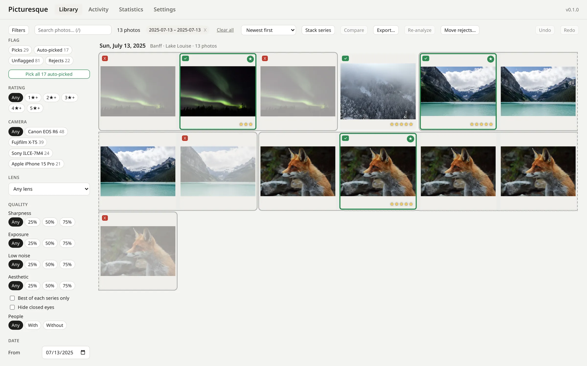

# Picturesque

Free, open-source photo culling for Linux, Windows and macOS.

Picturesque groups your bursts, finds the sharpest frame and suggests the
keepers, with AI that runs on your own computer. No subscription, no
account, no uploads.

**[Website](https://denyszorinets.github.io/picturesque/)** ·
**[Download](https://github.com/denyszorinets/picturesque/releases/latest)** ·
**[Documentation](https://denyszorinets.github.io/picturesque/docs/)**



## Features

- **Import:** copies photos from watched folders into a clean library built
  from a template (date, place, camera, …), skipping duplicates and
  verifying every copy. Originals are never modified.
- **Series and best shots:** bursts grouped into series, each photo scored for
  sharpness, exposure and noise (plus aesthetics and closed eyes with the
  optional local models), the best frame marked and suggested as a keeper.
- **Culling:** pick, reject and rate from the keyboard, in the grid, the
  photo view or side by side in Compare; every decision can be undone.
- **Search and filters:** by flag, rating, camera, lens, place, date and
  scores, or by describing a photo ("dog on a beach").
- **AI critic (optional):** a local vision-language model critiques a photo
  (rating, strengths, weaknesses, how to fix it, camera tips), in the photo
  view or in the background across the library, with Professional, Amateur
  and Beginner presets. The critique feeds the aesthetic score.
- **Insights:** recurring problems, rating trend by quarter and settings
  habits across all your critiques.
- **Statistics:** which cameras and lenses give you keepers, and the focal
  lengths you use.
- **Interoperability:** decisions written to XMP sidecars for darktable,
  digiKam and Lightroom; export picks as originals or resized JPEGs.

## Development

Built with Rust, Tauri 2 and Svelte 5. The devcontainer in `.devcontainer/`
has every dependency installed.

```bash
make check       # format check, clippy, tests, build
make docs-serve  # documentation preview
```

See `docs/development/building.rst` for details and
`docs/architecture/` for the architecture and decision records.

## License

GPL-3.0-or-later. See [LICENSE](LICENSE).
